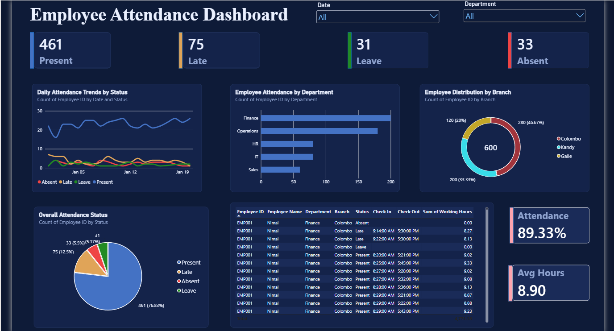

# Employee Attendance Dashboard (Power BI)

An interactive Power BI dashboard that analyses employee attendance across branches and departments.



## Overview
- Dataset: 600 attendance records, 30 employees, 20 working days
- Scope: 3 branches (Colombo, Kandy, Galle) and 5 departments (Finance, Operations, HR, IT, Sales)

## Key metrics
| Metric | Value |
|---|---|
| Present | 461 |
| Late | 75 |
| Leave | 31 |
| Absent | 33 |
| Attendance rate | 89.3% |
| Avg working hours | 8.9 |

## Visuals
- Daily attendance trend by status
- Attendance by department (Present + Late)
- Record distribution by branch
- Overall status breakdown
- Employee detail table with date and department slicers

## DAX measures
```
Attendance Rate = DIVIDE(
    CALCULATE(COUNTROWS(Sheet1), Sheet1[Status] IN {"Present","Late"}),
    COUNTROWS(Sheet1))

Avg Working Hours = CALCULATE(AVERAGE(Sheet1[Working Hours]),
    Sheet1[Status] IN {"Present","Late"})
```

## Files
- Employee_Attendance_Dataset.xlsx`: source data
- Employee_Attendance.pbix`: Power BI report
- dashboard.png`: dashboard screenshot

## Data
The dataset is sample data used for practice and does not contain real employee information.

## Tools
Power BI Desktop, DAX, Excel
